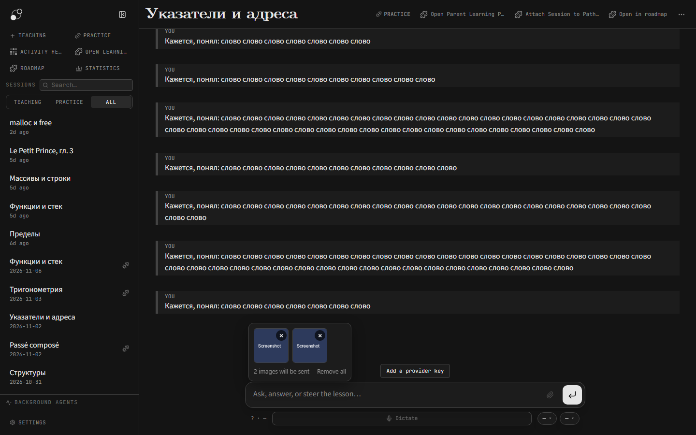

# Paste Images — LearnHarness plugin

Paste a screenshot with **Ctrl+V** (or drop an image file) into any field of a
LearnHarness session, and it is sent to the model together with your message.



- Works in the message field, in practice "thinking" and in the thinking field
  of an answer.
- Pasted images wait in a small tray above the field; remove any with **×**.
- You can send images without text.
- Large screenshots are scaled to at most 2000 px on the long side (and
  re-encoded as JPEG when still too big), so they fit model image limits.
- Up to 6 images per message.
- Images are cleared only after LearnHarness confirms the message was accepted;
  if sending fails, they stay.
- Text copied together with an image (for example from a document) still
  pastes as text.

The model must be able to read images (the vision-capable model you use in
LearnHarness).

## Install

1. Download `paste-images-<version>.zip` from the latest release.
2. In LearnHarness open **Settings → Community plugins** and copy the plugins
   directory path.
3. Unzip there so that `<plugins-directory>/paste-images/dist/manifest.json`
   exists.
4. Press **Refresh**, enable **Paste Images**, and restart LearnHarness.

From source:

```sh
git clone https://github.com/Doshhhh/paste-images-learnharness.git
cd paste-images-learnharness
npm ci
npm run install:local -- "<plugins-directory>"
```

## Privacy

Images stay in the app window until you send the message; nothing is stored on
disk by the plugin. They go to your model through LearnHarness's own connection,
exactly like an attached image.

## Development

```sh
npm ci
npm test
npm run typecheck   # needs the LearnHarness plugin SDK types in .sdk/
npm run build
```

## License

[MIT](./LICENSE)
